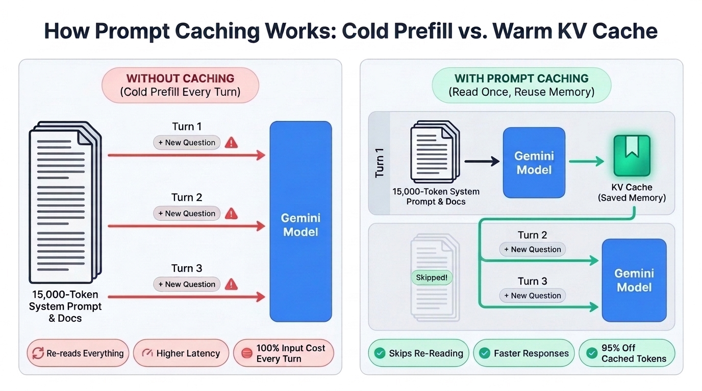
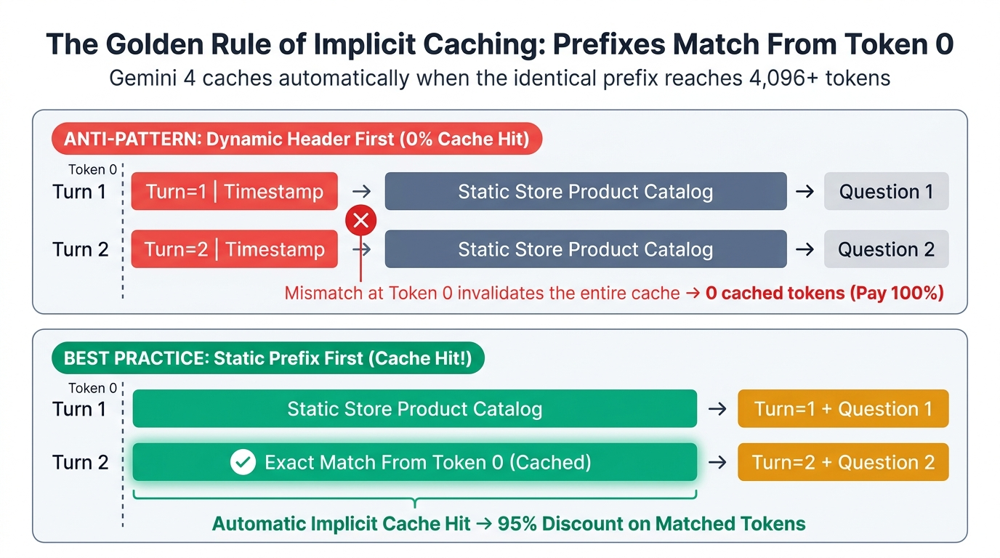
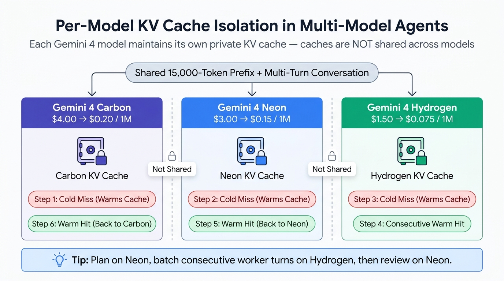
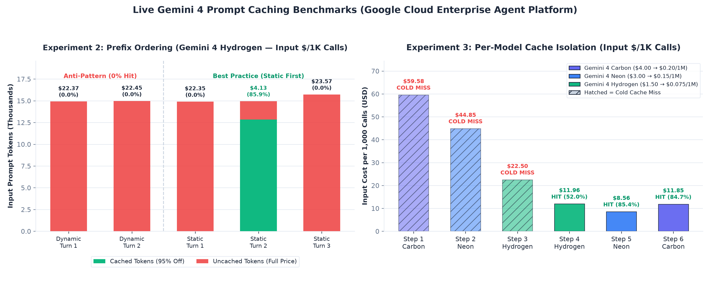
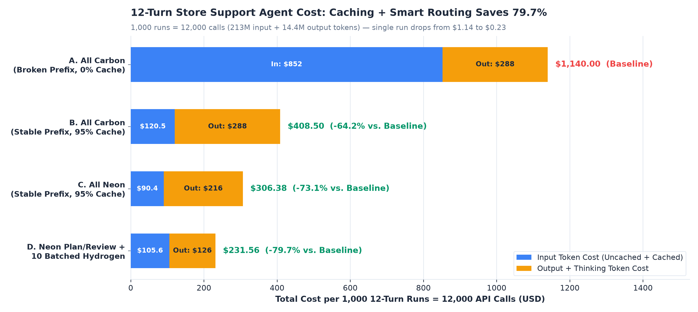

# Prompt Caching Explained Simply: Cut Your Gemini 4 Bills by Up to 80% (With Real Python Examples)

*A plain-English, step-by-step guide to what prompt caching actually is, how it works behind the scenes using an everyday online store example, why one tiny timestamp can silently wipe out your savings, and how caching behaves across Gemini 4 Carbon, Neon, and Hydrogen — backed by official Google docs, live Google Cloud runs, and exact dollar math.*

---

## A Quick Note Before We Begin: Credit & Why We Took a Different Approach

This post was inspired by an excellent official Google Cloud notebook by **Eric Dong** and **Holt Skinner**: [Per-model prompt caching across Gemini 4 Carbon, Neon, and Hydrogen](https://github.com/GoogleCloudPlatform/generative-ai/blob/main/gemini/context-caching/gemini_4_per_model_prompt_caching.ipynb). Their notebook does a great job demonstrating how Gemini 4's automatic caching behaves across models, why prompt ordering matters, and how multi-model agents can dramatically cut costs.

When I read through it, though, I realized that many developers — especially folks who are newer to building with Large Language Models (LLMs) — might jump straight into terms like *KV caches*, *cold prefill*, *prefix matching*, and distributed microservice specs and still wonder: **"Wait... what is prompt caching actually doing behind the scenes, and why should I care?"**

So instead of just summarizing that notebook, we are taking a deliberately different approach in this article:

1. **We start from absolute basics in plain English.** Before touching a single line of code, we will build a crystal-clear mental model of what prompt caching is, trace step-by-step what happens on Request #1 vs. Request #2 vs. Request #3, and verify every rule and price against official Google documentation.
2. **We use simple, standalone Python scripts instead of a notebook.** Every experiment is a short, readable `.py` program you can clone from the companion GitHub repository ([rominirani/gemini-4-prompt-caching](https://github.com/rominirani/gemini-4-prompt-caching)), run directly in your terminal, and easily adapt into a real backend or agent.
3. **We use a simpler, everyday example.** Instead of distributed-systems microservices, we built our own **SunnyMart Online Store Product Catalog** (`SKU-001` through `SKU-190`) so you can focus 100% on how caching works, how many tokens get cached on each run, and what every single call actually costs in real dollars.

All five Python programs were executed live on Google Cloud ([Gemini Enterprise Agent Platform](https://docs.cloud.google.com/gemini-enterprise-agent-platform)) using `google-genai 3.6.1`, and every number you see below is verbatim real output (saved in [results/experiment_results.json](https://github.com/rominirani/gemini-4-prompt-caching/blob/main/results/experiment_results.json)).

---

## The Hidden Cost Inside Almost Every AI App

If you are building a chatbot, a store support assistant, or an AI agent with a Large Language Model (LLM), you are probably paying for the same text over and over again without even noticing.

Here is why. Suppose you build a customer-support bot for an online shop called **SunnyMart**. Every time a shopper asks a tiny 1-line question — *"What is the shipping weight for SKU-020?"* — your app does not send *only* that 1-line question to the AI model. Behind the scenes, your code also attaches:

- Your system instructions (how the assistant should talk to shoppers)
- Your store's full product catalog (say, 190 products with prices, warranties, and shipping weights)
- All of the earlier messages in the conversation

Every single time the shopper asks a follow-up question, your app mails that entire product catalog to the model **all over again**.

Without caching, the AI model reads the entire catalog from word one on every single turn, and you pay full price every single time.

**Prompt Caching** (also called **Context Caching**) solves this problem. On **Gemini 4** models, it runs automatically in the background and discounts repeated input tokens by **95%** (per the official [Gemini API Pricing](https://aistudio.google.com/docs/pricing) and [Context Caching](https://aistudio.google.com/docs/caching) documentation).

The catch? Small, innocent coding habits — like putting today's timestamp at the top of your system prompt, or switching back and forth between models on every turn — can quietly drop your cache savings straight to **0%**.

Let's unpack how all of this works from the ground up — and then test every single rule live in Python.

---

## What We Will Cover

1. **What Prompt Caching Is (No Jargon):** An everyday analogy + a concrete step-by-step walkthrough of what happens on Request #1 vs. Request #2 vs. Request #3.
2. **Official Gemini 4 Rules & Pricing:** Verified token ratios, exact standard prices for Hydrogen, Neon, and Carbon (with links to Google's official docs), plus two real-world quirks you will see on your own runs.
3. **Five Simple Python Programs Run Live on Google Cloud:**
   - **Experiment 1:** Why you should *not* create caches manually on Gemini 4 (`HTTP 400`).
   - **Experiment 2:** How one changing timestamp at the top breaks caching — and how moving it to the end cuts input cost by **81.6%**.
   - **Experiment 3:** Why Carbon, Neon, and Hydrogen do **not** share each other's memory (and how each model remembers you when you come back).
   - **Experiment 4:** A full 12-turn store support agent bill (**$1,140.00 down to $217.31** per 1,000 runs).
   - **Experiment 5:** Letting Google manage conversation history with the **Interactions API** while keeping cache hits above **83%–85%**.
4. **A 5-Rule Cheat Sheet & Official Reference Links** you can bookmark and verify yourself.

---

## Part 1: What Is Prompt Caching? (Step by Step, With a Real Example)

First, a quick 10-second refresher on **tokens**: AI models don't bill by word count; they break text into small pieces called **tokens**. According to Google's official [Understand and count tokens](https://aistudio.google.com/docs/tokens) guide, **1 token is roughly 4 characters in English**, and **100 tokens equals about 60–80 English words**. That means:

- **1,000 tokens** ≈ **600–800 English words**
- **4,096 tokens** (Gemini 4's caching threshold) ≈ **2,450–3,275 English words**
- **15,000 tokens** (our SunnyMart product catalog) ≈ **9,000–12,000 English words**

Now imagine you hire a smart store clerk to answer ten quick customer questions using your store's thick printed product catalog.

- **Without prompt caching:** Every time a customer asks a new question, the clerk gets total amnesia. Before answering Question 2, they have to sit down and re-read the entire catalog from Page 1. Before Question 3, they re-read the entire catalog *again*. By Question 10, you have paid them to read the whole catalog **10 full times** just to answer ten 1-sentence questions.
- **With prompt caching:** On Question 1, the clerk reads the catalog **once** and writes down a neat set of study notes on their desk. When Question 2 arrives, they glance at their study notes, read *only* the new 1-line customer question, and answer immediately — at a **95% discount** for the part they already studied.


*Figure 1: Without caching (left), the model re-reads your entire 15,000-token system prompt and catalog on every turn. With prompt caching (right), Turn 1 reads the catalog once and saves its study notes (called the KV Cache), so later turns skip the heavy re-reading and cost 95% less on the cached part.*

### Step by Step: What Actually Happens When You Send Three Requests?

Forget complicated neural-network formulas. Let's trace our **SunnyMart** customer-support bot, which always attaches our **~15,000-token Store Product Catalog** to every prompt.

#### Step 1: Your app sends Request #1 (Cold Start)

```text
REQUEST #1 sent to Gemini:
┌────────────────────────────────────────────────────────────────┐
│ [Beginning of prompt — ~15,000 tokens]                         │
│ "You are a friendly SunnyMart store support assistant...       │
│  ## Item SKU-001: Everyday Ceramic Mug — $11.00, 201 grams...  │
│  ... ## Item SKU-190: Scented Soy Desk Candle — $200, 390g"    │
├────────────────────────────────────────────────────────────────┤
│ [End of prompt — 12 tokens]                                    │
│ Shopper asks: "What is the shipping weight for SKU-010?"       │
└────────────────────────────────────────────────────────────────┘
```

Here is what Gemini does behind the scenes in two simple stages:

1. **Stage 1 — Reading (called *Prefill*):** Gemini reads every word from the very beginning (**Token 0**) to the end. As it reads, it builds internal "study notes" in memory so it understands all 190 products. *(Engineers call those saved study notes the **KV Cache** — short for Key-Value Cache. You never have to touch the math; just picture a saved snapshot of the model's brain right after finishing the catalog!)*
2. **Stage 2 — Writing (called *Decode*):** Using those study notes, Gemini writes its answer one token at a time: *"The shipping weight for SKU-010 (Scented Soy Desk Candle, Edition 1) is 210 grams."*

Before Gemini finishes Request #1, Google's server quietly keeps a copy of those study notes in fast memory.

- **Cost of Request #1:** You pay **100% full price** for all ~15,012 input tokens, because this was the first time Gemini read the catalog.

#### Step 2: Five seconds later, your app sends Request #2 (Cache Hit!)

```text
REQUEST #2 sent to Gemini:
┌────────────────────────────────────────────────────────────────┐
│ [Beginning of prompt — EXACT SAME ~15,000 tokens!]             │
│ "You are a friendly SunnyMart store support assistant...       │
│  ## Item SKU-001: Everyday Ceramic Mug — $11.00, 201 grams...  │
│  ... ## Item SKU-190: Scented Soy Desk Candle — $200, 390g"    │
├────────────────────────────────────────────────────────────────┤
│ [End of prompt — brand-new question]                           │
│ Shopper asks: "What is the shipping weight for SKU-020?"       │
└────────────────────────────────────────────────────────────────┘
```

Watch what happens now:

1. Gemini checks Request #2 **starting from the very first character (Token 0)** and compares it with its saved memory.
2. *"Aha! The opening catalog tokens match what I already studied 5 seconds ago word-for-word!"*
3. Instead of re-reading all 190 products, Gemini **reloads its saved study notes in a flash**, reads only the small new ending, and writes the answer.
4. Because Google's servers skipped most of the heavy reading work, Google gives you **95% off those repeated input tokens!**

#### Step 3: Now watch what breaks everything (Request #3 — Cache Miss!)

Suppose you want the bot to know the exact current clock time, so you put a timestamp at the **very top** before the catalog:

```text
REQUEST #1 starts with: "[Turn=1 | Time=1795495401] You are a SunnyMart assistant... [Catalog]"
REQUEST #2 starts with: "[Turn=2 | Time=1795495406] You are a SunnyMart assistant... [Catalog]"
                                                ▲
                                   DIFFERENT AT THE VERY START!
```

Even though all 190 products right below it are 100% identical, **caching completely fails (0% cache hit!)**.

**Why?** Think about reading a mystery novel. Every chapter builds on what you read in Chapter 1. If someone rewrites Page 1 of the book (*"The butler did it"* → *"The gardener did it"*), every note you took in Chapters 2 through 30 could now mean something different! An AI model works the exact same way — it reads strictly left to right from **Token 0**. The moment *even one token changes*, everything that comes *after* that token has to be re-read from scratch.

**The golden rule:** Always put text that **never changes** (instructions, catalogs, tool definitions) at the **beginning**, and put text that **changes every time** (timestamps, turn numbers, the shopper's new question) at the **very end**.

### Why Prompt Caching Matters (3 Real Benefits)

1. **Up to 95% Lower Input Bills:** Cached input tokens on Gemini 4 cost **20× less** than normal input tokens ([Gemini API Pricing](https://aistudio.google.com/docs/pricing)).
2. **Faster Answers:** Skipping re-reading on 15,000+ tokens cuts waiting time — in our live experiments below, you will see response times drop by **42% to 49%** on cache hits!
3. **Simpler Apps:** You don't need to build a complex search/RAG database just to answer questions over a medium-sized product catalog or handbook — you can put the whole catalog cleanly in your prompt prefix and let caching keep it affordable.

---

## Part 2: Official Gemini 4 Caching Rules & Pricing

If you used older Gemini models (like Gemini 2.5 or Gemini 3), you might remember having to write extra code (`client.caches.create(...)`) to manually create a cache, pick an expiration timer, and pay hourly storage fees.

**On Gemini 4, all of that manual setup is gone.** According to Google's official [Context Caching Guide](https://aistudio.google.com/docs/caching), Gemini 4 models support **Implicit Caching only** (explicit caching is not supported):

- **Zero setup code:** It is enabled automatically by default on every request.
- **Zero storage fees:** You never pay hourly storage fees to hold a cache open.
- **Minimum size:** Implicit caching triggers automatically once your shared prompt prefix reaches **4,096 tokens** ([~2,450–3,275 English words](https://aistudio.google.com/docs/tokens)).

Here are the verified **Standard Tier** (`location="global"`) rates from the official [Gemini API Pricing](https://aistudio.google.com/docs/pricing) and [Google Cloud Model Garden Pricing](https://cloud.google.com/model-garden/pricing) pages:

| Model | Best Used For | Normal Input (per 1M) | Cached Input (per 1M — **95% Off**) | Output + Thinking (per 1M) | Min Prefix |
| :--- | :--- | :--- | :--- | :--- | :--- |
| **[Gemini 4 Hydrogen](https://aistudio.google.com/docs/pricing#gemini-4-hydrogen)** (`gemini-4-hydrogen`) | Fast everyday work & worker loops | $1.50 | **$0.075** | $7.50 | 4,096 tokens |
| **[Gemini 4 Neon](https://aistudio.google.com/docs/pricing#gemini-4-neon)** (`gemini-4-neon`) | Balanced planning & fast reasoning | $3.00 | **$0.150** | $15.00 | 4,096 tokens |
| **[Gemini 4 Carbon](https://aistudio.google.com/docs/pricing#gemini-4-carbon)** (`gemini-4-carbon`) | Deepest frontier reasoning | $4.00* | **$0.200*** | $20.00* | 4,096 tokens |

*\*Pricing notes from official docs: (1) [Gemini 4 Carbon](https://aistudio.google.com/docs/pricing#gemini-4-carbon) offers introductory promotional pricing ($2.00 input / $0.10 cached / $10.00 output per 1M tokens) through November 30, 2026; standard pricing ($4.00 / $0.20 / $20.00) takes effect December 1, 2026 and is used throughout this post so all calculations stay evergreen. (2) Rates above are for the `global` endpoint; check [Google Cloud Model Garden Pricing](https://cloud.google.com/model-garden/pricing) for regional endpoint rates.*

#### Let's Make Those Numbers Feel Real

"Per 1 million tokens" sounds abstract, so let's plug in a real number. Suppose your SunnyMart catalog is **15,000 input tokens**, and your store answers **1,000 customer questions** today (`15,000 × 1,000 = 15,000,000` tokens = 15 million tokens) using **Gemini 4 Hydrogen**:

- **With 0% caching (full price):** `15M × $1.50` = **$22.50**
- **If all 15K were cached (95% off):** `15M × $0.075` = **$1.13**

That is the difference between **$22.50** and **$1.13** for the exact same answers.

### Two Real-World Quirks You Should Expect (Before Running Code!)

When you run your own caching tests, two behaviors might surprise you unless you know about them upfront:

#### Quirk 1: Why is my cache hit ~85%–86% instead of 99.9% on short chats?

Suppose Turn 1 had **15,000 tokens**, and on Turn 2 the customer asks a tiny 15-token follow-up question. You might expect Gemini to cache **14,985 tokens (99.9%)**. Instead, you will see roughly **12,950 tokens cached (~86%)** and **~2,065 tokens charged at full price**!

Here is what Gemini 4 is doing, straight from the official [Context Caching Guide](https://aistudio.google.com/docs/caching):

```text
Your ~15,015-token Turn 2 request:
┌───────────────────────────────────────────┬──────────────────────────┐
│ Token 1 ...................... Token 12,950│ Token 12,951 ... 15,015  │
│        Reused from cache (95% OFF!)        │ Re-read (~2,065 tokens)  │
└───────────────────────────────────────────┴──────────────────────────┘
```

On Gemini 4, **if a follow-up request adds fewer than 2,050 new tokens** (including the model's reply, thinking tokens, and tool results), Gemini re-processes the last **2,050 tokens** of the previous request at the standard input rate. Once a heavier agent turn adds at least 2,050 new tokens (for example, returning a long tool response or document excerpt), Gemini caches **100%** of the previous request!

#### Quirk 2: The "Busy Coffee Shop" Effect (Why a Tiny Test Can Occasionally Miss)

Think of Google Cloud like a busy coffee shop with several baristas working behind the counter (distributed servers).
- On Request #1, **Barista A** learns your 15,000-token SunnyMart catalog and saves their notes.
- Two seconds later, if Request #2 lands with **Barista A**, you get an instant **85.9% cache hit**!
- If Request #3 happens to get routed to **Barista B** (who hasn't seen your catalog yet), you may see one occasional cache miss (`0%`) — or a partial block hit (`8,192` tokens) — while that server warms up too.
- In a real production app with steady traffic (or consecutive batched turns on one model), servers stay warm and hit rates stay high.

You will see **both** of these real-world behaviors happen honestly in our live Google Cloud runs below.

---

## Part 3: Our Simple Python Setup ([common.py](https://github.com/rominirani/gemini-4-prompt-caching/blob/main/common.py))

Instead of a Jupyter notebook, we built **five small, standalone Python scripts** in [`examples/`](https://github.com/rominirani/gemini-4-prompt-caching/tree/main/examples) that share one tiny helper file, [`common.py`](https://github.com/rominirani/gemini-4-prompt-caching/blob/main/common.py).

Rather than reusing the distributed-systems microservice jargon from the original notebook, we created an original, super-simple **SunnyMart Online Store Product Catalog** listing **190 everyday products** (`SKU-001` through `SKU-190`). When tokenized by Gemini, those 190 items come out to **~14,900 tokens** — right around the 15,000-token ballpark we used in our walkthrough above, and comfortably above Gemini 4's 4,096-token caching minimum.

Here is what the first few lines of that generated catalog actually look like:

```text
You are a friendly SunnyMart store support assistant (static-first demo). Use the product catalog below and answer concisely in 1 sentence.

## Item SKU-001: Everyday Ceramic Mug (Edition 1)
- Category: Kitchen | Unit Price: $11.00 | Warranty: 12 months
- Return Window: 30 days | Shipping Weight: 201 grams
- Support Note: Free standard shipping on orders over $50; gift wrapping available.
## Item SKU-002: Insulated Travel Tumbler (Edition 1)
- Category: Kitchen | Unit Price: $12.00 | Warranty: 12 months
- Return Window: 30 days | Shipping Weight: 202 grams
- Support Note: Free standard shipping on orders over $50; gift wrapping available.
... (continues up to SKU-190, ~14,900 tokens total)
```

Notice how simple and easy to verify every product is:
- `SKU-001` (Everyday Ceramic Mug): **$11.00**, **201 grams**
- `SKU-002` (Insulated Travel Tumbler): **$12.00**, **202 grams**
- `SKU-010` (Scented Soy Desk Candle, Edition 1): **$20.00**, **210 grams**
- `SKU-020` (Scented Soy Desk Candle, Edition 2): **$30.00**, **220 grams**

Here is the core setup inside `common.py` connecting to [Gemini Enterprise Agent Platform](https://docs.cloud.google.com/gemini-enterprise-agent-platform) with `google-genai 3.6.1`:

```python
import os
from google import genai
from google.genai import types

CARBON_MODEL = "gemini-4-carbon"
NEON_MODEL = "gemini-4-neon"
HYDROGEN_MODEL = "gemini-4-hydrogen"

# Standard per-1M input token rates in USD: (normal_price, cached_price)
# Source: https://aistudio.google.com/docs/pricing
INPUT_RATES_PER_1M = {
    HYDROGEN_MODEL: (1.50, 0.075),
    NEON_MODEL: (3.00, 0.150),
    CARBON_MODEL: (4.00, 0.200),
}

OUTPUT_RATES_PER_1M = {
    HYDROGEN_MODEL: 7.50,
    NEON_MODEL: 15.00,
    CARBON_MODEL: 20.00,
}

def create_client() -> genai.Client:
    return genai.Client(
        enterprise=True,
        project=os.environ["GOOGLE_CLOUD_PROJECT"],
        location=os.environ.get("GOOGLE_CLOUD_LOCATION", "global"),
        http_options=types.HttpOptions(
            timeout=240_000,
            retry_options=types.HttpRetryOptions(attempts=3),
        ),
    )
```

And here is the exact 4-line cost math `common.py` runs after every single API call:

```python
uncached_tokens = max(0, prompt_tokens - cached_tokens)
uncached_cost = (uncached_tokens * uncached_rate) / 1_000_000
cached_cost   = (cached_tokens   * cached_rate)   / 1_000_000
input_cost    = uncached_cost + cached_cost
```

Every output and cost table below comes straight from running these five scripts live on Google Cloud.

---

## Experiment 1: Why You Shouldn't Create Caches Manually on Gemini 4 ([01_explicit_cache_check.py](https://github.com/rominirani/gemini-4-prompt-caching/blob/main/examples/01_explicit_cache_check.py))

**Goal:** Show what happens if you bring old Gemini 2.5 / 3.x manual caching code (`client.caches.create`) over to Gemini 4.

```python
from google.genai import types
from google.genai.errors import APIError
from common import NEON_MODEL, build_store_catalog_prefix, create_client

client = create_client()
catalog = build_store_catalog_prefix("explicit check")

try:
    client.caches.create(
        model=NEON_MODEL,
        config=types.CreateCachedContentConfig(
            contents=[catalog],
            ttl="300s",
        ),
    )
except APIError as err:
    print(f"Expected guardrail -> HTTP {err.code}: {err.message}")
```

### Real Output From Google Cloud

```text
=== Experiment 1: Explicit Context Caching Check (Gemini 4) ===
Attempting client.caches.create() on model: gemini-4-neon

Expected guardrail -> HTTP 400: Model `gemini-4-neon` does not support explicit context caching.
```

**What happened:** Gemini 4 immediately returned **`HTTP 400`** confirming explicit caching is not supported (matching the [Context Caching Guide](https://aistudio.google.com/docs/caching)).

**What you should do:** When upgrading an existing app to Gemini 4, simply **delete** any `client.caches.create()` calls and `cached_content=...` fields. Less code to maintain, zero hourly storage fees, and implicit caching runs automatically!

---

## Experiment 2: How One Timestamp Silently Breaks Your Cache ([02_prefix_ordering.py](https://github.com/rominirani/gemini-4-prompt-caching/blob/main/examples/02_prefix_ordering.py))

**Goal:** Prove live on **`gemini-4-hydrogen`** (`$1.50` normal / `$0.075` cached per 1M tokens) how changing **one tiny line at the very start** destroys caching, while moving that exact same changing text to the **end** slashes input costs by **81.6%**.

Remember the exact order Gemini reads your API request from **Token 0**:

`system_instruction` → `tools` → `contents` (the conversation messages)

Let's compare what we send in **Part A (Broken)** vs. **Part B (Fixed)** side by side:

```text
PART A (BROKEN — changes at the very start!):
  Turn 1 system_instruction: "[Turn=1 | RequestTimestamp=1795495580]\n" + [SunnyMart Catalog]
  Turn 2 system_instruction: "[Turn=2 | RequestTimestamp=1795495585]\n" + [SunnyMart Catalog]
                              ▲ Line 1 changed! Gemini throws away the whole cache!

PART B (FIXED — identical from Token 0!):
  Turn 1 system_instruction: [SunnyMart Catalog]  + user msg: "[Turn=1] What is the shipping weight for SKU-010?"
  Turn 2 system_instruction: [SunnyMart Catalog]  + user msg: "[Turn=2] What is the shipping weight for SKU-020?"
  Turn 3 system_instruction: [SunnyMart Catalog]  + user msg: "[Turn=3] What is the shipping weight for SKU-030?"
                              ▲ Exact match from Token 0! Automatic cache hit!
```


*Figure 2: Top (Anti-Pattern): Putting `[Turn=N | Timestamp]` at Token 0 breaks matching on every turn (0% cached). Bottom (Best Practice): Keeping the Static Store Product Catalog untouched at Token 0 and moving the turn counter to the end unlocks automatic 95%-discounted caching.*

Here is the simplified code from `examples/02_prefix_ordering.py`:

```python
# PART A — BROKEN: changing clock timestamp at the start of system_instruction
for turn in (1, 2):
    bad_system_instruction = (
        f"[Turn={turn} | RequestTimestamp={int(time.time())}]\n"
        + catalog_prefix
    )
    history.append(
        types.Content(
            role="user",
            parts=[types.Part.from_text(text=f"What is the shipping weight for SKU-0{turn}0?")],
        )
    )
    resp = client.models.generate_content(
        model=HYDROGEN_MODEL,
        contents=history,
        config=types.GenerateContentConfig(
            system_instruction=bad_system_instruction,
            thinking_config=types.ThinkingConfig(thinking_level="LOW"),
        ),
    )

# PART B — FIXED: system_instruction never changes; dynamic turn goes at the END
for turn in (1, 2, 3):
    history.append(
        types.Content(
            role="user",
            parts=[types.Part.from_text(text=f"[Turn={turn}] What is the shipping weight for SKU-0{turn}0?")],
        )
    )
    resp = client.models.generate_content(
        model=HYDROGEN_MODEL,
        contents=history,
        config=types.GenerateContentConfig(
            system_instruction=catalog_prefix,  # Unchanged from Token 0!
            thinking_config=types.ThinkingConfig(thinking_level="LOW"),
        ),
    )
```

### Real Output From Google Cloud

```text
=== Experiment 2: Prefix Ordering (Dynamic-First vs. Static-First) ===

--- Part A: Dynamic Header at the Start (Anti-Pattern) ---
Dynamic-first Turn 1: prompt=14,915, cached=0 ( 0.0%), out+think=100, latency=4.15s | input=$0.02237/call ($22.37/1K calls)
  Answer: The shipping weight for SKU-010 (Scented Soy Desk Candle, Edition 1) is 210 grams.
Dynamic-first Turn 2: prompt=14,965, cached=0 ( 0.0%), out+think=32, latency=1.68s | input=$0.02245/call ($22.45/1K calls)
  Answer: The shipping weight for SKU-020 (Scented Soy Desk Candle, Edition 2) is 220 grams.

--- Part B: Static Catalog First, Dynamic Text at End (Best Practice) ---
Static-first  Turn 1: prompt=14,900, cached=0 ( 0.0%), out+think=100, latency=3.39s | input=$0.02235/call ($22.35/1K calls, saves 0.0%)
  Answer: The shipping weight for SKU-010 (Scented Soy Desk Candle, Edition 1) is 210 grams.
Static-first  Turn 2: prompt=14,955, cached=12,846 (85.9%), out+think=28, latency=1.72s | input=$0.00413/call ($4.13/1K calls, saves 81.6%)
  Answer: The shipping weight for SKU-020 (Scented Soy Desk Candle, Edition 2) is 220 grams.
Static-first  Turn 3: prompt=15,711, cached=0 ( 0.0%), out+think=28, latency=2.21s | input=$0.02357/call ($23.57/1K calls, saves 0.0%)
  Answer: The shipping weight for SKU-030 (Scented Soy Desk Candle, Edition 3) is 230 grams.
```

### Walking Through Every Turn Like a Grocery Receipt

Let's read what actually happened on every turn:

- **Broken Turn 1 & Turn 2:** Both turns got **`cached = 0` (0.0%)** because Line 1 changed from `Turn=1` to `Turn=2` with a new timestamp. We paid **$22.37** and **$22.45 per 1,000 calls** — full price every time.
- **Fixed Turn 1:** First time seeing this catalog, so **`cached = 0`** (cold start). It took **3.39 seconds** and cost **$22.35 per 1,000 calls**.
- **Fixed Turn 2 (BOOM — Instant Cache Hit!):** Out of **14,955** total input tokens, Gemini reused **12,846 tokens (85.9%)** straight from memory! Response time dropped nearly in half — from **3.39s down to 1.72s** (**49% faster!**).
- **Fixed Turn 3 (Real-World "Coffee Shop" Quirk):** Remember Quirk 2 above? On Turn 3, our single request routed to a different server in the `global` pool (`cached = 0`). That is totally normal in tiny 3-turn experiments because implicit caching is best-effort across servers — in real production traffic with steady requests, servers stay warm and hit rates remain high!

Now check the exact grocery-receipt math for **Fixed Turn 2**:

| Line Item on Static-First Turn 2 | Tokens | Official Rate (per 1M) | Cost for 1 Call | Cost for 1,000 Calls |
| :--- | ---: | ---: | ---: | ---: |
| **Cached input** (reused study notes) | 12,846 | $0.075 | $0.000963 | **$0.96** |
| **Uncached input** (~2,050 trailing window + 59 new tokens) | 2,109 | $1.500 | $0.003164 | **$3.16** |
| **Total Input Bill (With Caching)** | **14,955** | — | **$0.004127** | **$4.13** |
| *What Input Would Have Cost Without Caching* | *14,955* | *$1.500* | *$0.022433* | *$22.43* |
| **Output + Thinking** (the 1-sentence answer) | 28 | $7.500 | $0.000210 | **$0.21** |

Look at those exact numbers:
- Input cost plunged from **$22.43 down to $4.13 per 1,000 calls** (**81.6% cheaper!**).
- Notice `14,955 − 12,846 = 2,109` uncached tokens — right on top of Gemini 4's documented **2,050-token** trailing window ([Context Caching Guide](https://aistudio.google.com/docs/caching))!

> [!TIP]
> **Common Accidental Cache-Busters to Remove From the Top of Your `system_instruction`:**
> - Current date/time (`Today is 2026-11-24 10:15:00 UTC`)
> - Random request IDs, trace IDs, or user session UUIDs
> - Tool lists or JSON keys whose order changes randomly between calls
>
> Put all static rules and catalogs **first**. Put anything that changes **at the very end** in the user message.

---

## Experiment 3: Does One Model Share Its Memory With Another Model? ([03_per_model_isolation.py](https://github.com/rominirani/gemini-4-prompt-caching/blob/main/examples/03_per_model_isolation.py))

**Goal:** See what happens when a store support agent switches between **Carbon**, **Neon**, and **Hydrogen** during the same conversation.

Think of the three Gemini 4 models like three different consultants working on your support team:
- **Gemini 4 Carbon** — Your senior specialist (deepest thinking, `$4.00/1M` input)
- **Gemini 4 Neon** — Your lead agent (smart & fast, `$3.00/1M` input)
- **Gemini 4 Hydrogen** — Your speedy frontline helper (very fast & cheapest, `$1.50/1M` input)

**Here is the rule:** Each consultant keeps their **own private notebook** (their own KV cache).
- If **Carbon** reads your 190-item catalog and takes notes, **Hydrogen cannot read Carbon's notebook**. The first time you ask Hydrogen a question, Hydrogen has to read the catalog once for itself (a cold start).
- **Good news, though:** While Hydrogen is working, **Carbon does NOT throw away its notebook!** When you come back to Carbon a few turns later, Carbon's notes are still open on its desk — instant cache hit!


*Figure 3: Carbon, Neon, and Hydrogen each keep their own separate KV Cache vault. Switching to a new model for the first time causes a cold miss, while returning to a previously warmed model hits its still-warm cache.*

To make sure Experiment 3 starts 100% cold (without accidentally matching Experiment 2's `SKU-001` cache on Hydrogen from moments earlier!), our script labels the catalog items `ITEM-001` through `ITEM-190` and runs **one 6-step conversation** in this exact order:

`Step 1: Carbon` → `Step 2: Neon` → `Step 3: Hydrogen` → `Step 4: Hydrogen` → `Step 5: Neon` → `Step 6: Carbon`

```python
catalog_prefix = build_store_catalog_prefix(
    "per-model isolation demo", sku_prefix="ITEM"
)

handoff_schedule = [
    (CARBON_MODEL,   "Step 1 (Carbon cold start): check shipping weight for ITEM-005."),
    (NEON_MODEL,     "Step 2 (Neon cold start): check shipping weight for ITEM-015."),
    (HYDROGEN_MODEL, "Step 3 (Hydrogen cold start): check shipping weight for ITEM-025."),
    (HYDROGEN_MODEL, "Step 4 (Hydrogen consecutive): check shipping weight for ITEM-035."),
    (NEON_MODEL,     "Step 5 (Back to warm Neon): check shipping weight for ITEM-045."),
    (CARBON_MODEL,   "Step 6 (Back to warm Carbon): check shipping weight for ITEM-055."),
]
```

### Real Output From Google Cloud

```text
=== Experiment 3: Per-Model KV Cache Isolation ===

Step & Model           |  Prompt |  Cached | Uncached | Out+Thk |  Hit % |   Time |   In $/1K
---------------------------------------------------------------------------------------------
1. gemini-4-carbon     |  14,895 |       0 |   14,895 |      29 |   0.0% |  7.76s | $  59.580
2. gemini-4-neon       |  14,951 |       0 |   14,951 |     113 |   0.0% |  3.40s | $  44.853
3. gemini-4-hydrogen   |  15,001 |       0 |   15,001 |      25 |   0.0% |  1.80s | $  22.502
4. gemini-4-hydrogen   |  15,754 |   8,192 |    7,562 |     137 |  52.0% |  2.58s | $  11.957
5. gemini-4-neon       |  15,110 |  12,902 |    2,208 |     130 |  85.4% |  2.94s | $   8.559
6. gemini-4-carbon     |  15,161 |  12,841 |    2,320 |      29 |  84.7% |  4.52s | $  11.848
```

### Step-by-Step Walkthrough of What Happened

Watch every single step in that live table:

1. **Step 1 (`Carbon` — first time):** Carbon's notebook is blank → **`0` cached**, pays **$59.58 / 1K calls** (`$0.060` per call), takes **7.76s**. Carbon saves its notes.
2. **Step 2 (`Neon` — first time):** Even though Carbon *just* read the exact same 14,900-token catalog seconds earlier, Neon's notebook is blank → **`0` cached**, pays **$44.85 / 1K calls**. Neon saves its notes.
3. **Step 3 (`Hydrogen` — first time):** Hydrogen's notebook is blank too → **`0` cached**, pays **$22.50 / 1K calls**. Hydrogen saves its notes.
4. **Step 4 (`Hydrogen` — second time in a row):** Hydrogen opens its own notebook and gets a partial block cache hit (**8,192 tokens cached — 52.0% hit!**), immediately cutting input cost nearly in half from **$22.50 down to $11.96 / 1K calls** (**49.4% savings** vs. the `$23.63/1K` uncached cost for 15,754 tokens). *(On consecutive turns, as you'll see in Experiment 5 right below, Hydrogen climbs straight to ~85.8%!)*
5. **Step 5 (Back to `Neon`):** Neon's notebook from Step 2 is **still open and warm!** → **12,902 tokens cached (85.4% hit!)**. Input cost drops from **$44.85 down to $8.56 / 1K calls** (**81.1% savings**!) and response time speeds up from `3.40s` to `2.94s`.
6. **Step 6 (Back to `Carbon`):** Carbon's notebook from Step 1 is **also still warm!** → **12,841 tokens cached (84.7% hit!)**. Input cost drops from **$59.58 down to $11.85 / 1K calls** (**80.5% savings**!), AND response time drops from **7.76s down to 4.52s** (**42% faster!**).

Here are both live experiments plotted side by side directly from our real Google Cloud telemetry:


*Figure 4: Left (Experiment 2): Moving the turn counter out of Token 0 drops Hydrogen input cost from $22.43 to $4.13 per 1,000 calls on Turn 2. Right (Experiment 3): Steps 1–3 pay one cold start per model (hatched bars), then Steps 4–6 hit each model's own warm cache (solid bars).*

---

## Experiment 4: How Much Does a Real 12-Turn Support Agent Cost? ([04_12_turn_cost_simulator.py](https://github.com/rominirani/gemini-4-prompt-caching/blob/main/examples/04_12_turn_cost_simulator.py))

Now let's zoom out to a realistic production **12-turn SunnyMart order-troubleshooting agent**:
- **Turn 1:** Plan how to resolve a complex multi-item order issue
- **Turns 2–11:** 10 worker turns (look up SKUs, compare warranties, calculate refunds, check shipping rules)
- **Turn 12:** Final quality review before replying to the customer

Let's trace the exact token growth of a single 12-turn run:
- Turn 1 sends **15,000 input tokens** (the store catalog) and writes **1,200 tokens** (thinking + answer).
- Turn 2 sends **15,500 input tokens** (catalog + 500 new tokens of context) and writes **1,200 tokens**.
- Each turn grows by **+500 input tokens**, reaching **20,500 input tokens** by Turn 12.

Our local Python script (`examples/04_12_turn_cost_simulator.py`, zero API cost to run!) calculates the exact bill for **1,000 full 12-turn runs** across four setups using the official [Gemini API Pricing](https://aistudio.google.com/docs/pricing):

### Real Output

```text
=== Experiment 4: 12-Turn Store Support Agent Cost Comparison ===

A. All Carbon (broken prefix, 0% cache)     -> $1140.00 / 1,000 runs ($1.1400/run | in=$852.00, out=$288.00 | saves  0.0%)
B. All Carbon (stable prefix, 95% cache)    -> $ 408.50 / 1,000 runs ($0.4085/run | in=$120.50, out=$288.00 | saves 64.2%)
C. All Neon (stable prefix, 95% cache)      -> $ 306.38 / 1,000 runs ($0.3064/run | in=$ 90.38, out=$216.00 | saves 73.1%)
D. Neon plan/review + 10 batched Hydrogen   -> $ 217.31 / 1,000 runs ($0.2173/run | in=$ 91.31, out=$126.00 | saves 80.9%)
```

Look closely at the **blue (reading/input)** vs. **orange (writing/output + thinking)** bars in Figure 5 — this reveals a huge lightbulb moment:


*Figure 5: Prompt caching alone cuts total cost from $1,140 to $408.50 (-64.2%). Notice the orange bar: once reading is cheap, writing (Output + Thinking) becomes 70% of your bill! Batching the 10 worker turns on Hydrogen drops the total all the way to $217.31 (-80.9%).*

Let's follow the story from top bar to bottom bar:

1. **Setup A → Setup B (`$1,140.00` → `$408.50`, saves `$731.50` / 64.2%):**
   We didn't change the model at all — we ONLY fixed our prompt prefix so it stayed identical from Token 0! That single change slashed the reading bill (blue) from **$852.00 down to $120.50**.
2. **The Big Surprise — Look at the Orange Bar!**
   In Setup B, reading is now only **$120.50**, while writing (Output + Thinking on Carbon at `$20.00/1M`) is **$288.00** — **70% of the entire invoice!** Why? Because prompt caching only discounts what the model *reads* (input), never what it *writes* (output + thinking).
3. **Setup B → Setup D (`$408.50` → `$217.31`, saves 80.9% total!):**
   Now look what happens when you combine **prompt caching** with **smart model batching**:
   - **Turn 1:** Use **Neon** to make a smart plan.
   - **Turns 2–11:** Batch all **10 worker turns consecutively on Hydrogen** (which charges `$7.50/1M` to write instead of Carbon's `$20.00/1M`!).
   - **Turn 12:** Hand back to **Neon** (whose cache is still warm!) for the final review.
   - Result: Writing costs drop from **$288.00 down to $126.00**, and your total bill drops from **$1.14 per agent run down to $0.22 per agent run!**

Here is the exact turn-by-turn receipt for **Setup D** (per 1,000 runs):

| Turn | Step & Model | Total Input | Cached (95% Off) | Uncached | Reading Cost ($/1K) | Writing Cost ($/1K) | Turn Total ($/1K) |
| :---: | :--- | ---: | ---: | ---: | ---: | ---: | ---: |
| 1 | Plan (`gemini-4-neon`) | 15,000 | 0 *(cold)* | 15,000 | $45.00 | $18.00 | **$63.00** |
| 2 | Worker 1 (`gemini-4-hydrogen`) | 15,500 | 0 *(cold)* | 15,500 | $23.25 | $9.00 | **$32.25** |
| 3 | Worker 2 (`gemini-4-hydrogen`) | 16,000 | 15,500 | 500 | $1.91 | $9.00 | **$10.91** |
| 4–10 | Workers 3–9 (`gemini-4-hydrogen`) | 16.5K–19.5K | 16K–19K | 500 | $1.95–$2.18 | $9.00 | **$10.95–$11.18** |
| 11 | Worker 10 (`gemini-4-hydrogen`) | 20,000 | 19,500 | 500 | $2.21 | $9.00 | **$11.21** |
| 12 | Review (`gemini-4-neon`) | 20,500 | 20,000 *(warm!)* | 500 | $4.50 | $18.00 | **$22.50** |
| **Total** | **All 12 Turns** | **213,000** | **182,500** | **30,500** | **$91.31** | **$126.00** | **$217.31** |

Look at Turns 2–11: Turn 2 pays a one-time **$23.25** fee to warm up Hydrogen's notebook, and then **Turns 3 through 11 cruise at ~$2.00 per 1,000 calls for reading!** That is why batching worker turns together on one model beats switching models every single turn.

---

## Experiment 5: Letting Google Track the Chat History With the Interactions API ([05_interactions_api_handoffs.py](https://github.com/rominirani/gemini-4-prompt-caching/blob/main/examples/05_interactions_api_handoffs.py))

In Experiments 2 and 3, our Python script had to maintain a manual `history = []` list and send the entire conversation array back to Google on every turn.

Google's newer **[Interactions API](https://aistudio.google.com/docs/interactions-overview)** (`client.interactions.create`) makes multi-turn apps much cleaner:
1. On Turn 1, you pass `store=True`. Google saves Turn 1 on its server and hands you back a receipt ID (`inter.id`).
2. On Turn 2, you **don't** re-send Turn 1! You simply pass `previous_interaction_id=prev_id` along with your fixed `system_instruction` and your brand-new short question.
3. Google stitches the conversation together on the server automatically — and **implicit prompt caching works automatically underneath** ([Context Caching Guide](https://aistudio.google.com/docs/caching))!

Let's watch a real 5-turn SunnyMart checkout workflow (`Neon Plan → 3× Hydrogen Workers → Neon Verify`) run live in `examples/05_interactions_api_handoffs.py`:

```python
turns_spec = [
    (NEON_MODEL,     "low", "Plan: list the unit prices for SKU-001 and SKU-002."),
    (HYDROGEN_MODEL, "low", "Worker 1: calculate the subtotal if a customer buys both items."),
    (HYDROGEN_MODEL, "low", "Worker 2: calculate the price difference between the two items."),
    (HYDROGEN_MODEL, "low", "Worker 3: format the subtotal and price difference as JSON."),
    (NEON_MODEL,     "low", "Verify: confirm the JSON matches the catalog prices for SKU-001 and SKU-002."),
]

prev_id = None
stored_ids = []

for idx, (model_id, level, prompt) in enumerate(turns_spec, start=1):
    kwargs = {
        "model": model_id,
        "system_instruction": catalog_prefix,  # Always pass the same static catalog
        "input": prompt,                       # Only send the NEW 1-line question!
        "generation_config": {"thinking_level": level},
        "store": True,
        "timeout": 180,
    }
    if prev_id is not None:
        kwargs["previous_interaction_id"] = prev_id

    inter = client.interactions.create(**kwargs)
    stored_ids.append(inter.id)
    prev_id = inter.id
```

### Real Output From Google Cloud

```text
=== Experiment 5: Batched Handoffs on the Interactions API ===

Turn & Model           |   Input |  Cached | Uncached | Out+Thk |  Hit % |   Time |   In $/1K
---------------------------------------------------------------------------------------------
1. gemini-4-neon       |  14,898 |       0 |   14,898 |     128 |   0.0% |  8.33s | $  44.694
2. gemini-4-hydrogen   |  14,968 |       0 |   14,968 |     109 |   0.0% |  7.67s | $  22.452
3. gemini-4-hydrogen   |  15,100 |  12,919 |    2,181 |      84 |  85.6% |  5.54s | $   4.240
4. gemini-4-hydrogen   |  15,207 |  13,051 |    2,156 |      79 |  85.8% |  6.27s | $   4.213
5. gemini-4-neon       |  15,403 |  12,841 |    2,562 |     171 |  83.4% |  7.88s | $   9.612

Cleaned up 5 stored interactions.
```

### Step-by-Step: What Each Turn Answered and Cost

Notice how each turn automatically knew what the previous turn said — even across different models — purely through `previous_interaction_id`:

1. **Turn 1 (`Neon` — Plan):** Answered *"The unit price is $11.00 for SKU-001 (Everyday Ceramic Mug, Edition 1) and $12.00 for SKU-002 (Insulated Travel Tumbler, Edition 1)."* Cold start (**0% cached**, `$44.69/1K`).
2. **Turn 2 (`Hydrogen` — Worker 1):** Answered *"The subtotal for buying both SKU-001 ($11.00) and SKU-002 ($12.00) is $23.00."* First Hydrogen call, so cold start (**0% cached**, `$22.45/1K`).
3. **Turn 3 (`Hydrogen` — Worker 2):** Answered *"The price difference between SKU-002 ($12.00) and SKU-001 ($11.00) is $1.00."* **Cache hit: 85.6%!** Input cost dropped to **$4.24/1K** (**81.3% savings**!).
4. **Turn 4 (`Hydrogen` — Worker 3):** Answered `{"subtotal": 23.00, "price_difference": 1.00}`. **Cache hit: 85.8%!** Input cost stayed at **$4.21/1K** (**81.5% savings**!).
5. **Turn 5 (`Neon` — Verify):** Answered *"Confirmed: the JSON values match the catalog prices for SKU-001 ($11.00) and SKU-002 ($12.00), yielding a subtotal of $23.00 and a price difference of $1.00."* **Neon's cache was still warm — 83.4% hit!** Input cost dropped from **$44.69 down to $9.61/1K** (**79.2% savings**!).

Finally, our script deleted all 5 stored interactions using `client.interactions.delete(interaction_id)` so nothing unnecessary stays stored on the server. *(Tip: Remember to still pass `system_instruction` on every turn in the Interactions API — as noted in the [Interactions API Overview](https://aistudio.google.com/docs/interactions-overview), `system_instruction` is interaction-scoped, meaning you re-send it on each turn!)*

---

## Your 5-Rule Prompt Caching Cheat Sheet

If you remember only five practical rules from this entire guide, save these:

1. **Remove manual cache code on Gemini 4.** Implicit caching is automatic, charges zero storage fees, and gives you **95% off** repeated input tokens once your shared prefix reaches **4,096 tokens** ([Context Caching](https://aistudio.google.com/docs/caching)).
2. **Never put changing text at the top.** Keep your instructions, catalogs, and tool definitions completely fixed starting from **Token 0**. Put timestamps, request IDs, and user questions at the **very end**.
3. **Log your cached tokens in production.** Print or log `usage_metadata.cached_content_token_count` (or `usage.total_cached_tokens` in the Interactions API). If it suddenly drops to `0`, someone probably slipped a changing string into the top of your prompt!
4. **Group consecutive turns on the same model.** Because Carbon, Neon, and Hydrogen each keep their own private cache, use **Plan (Neon) → Batch Workers (Hydrogen) → Review (Neon)** instead of jumping back and forth every turn.
5. **Watch your Output + Thinking bill once Input is cached.** Once caching makes reading super cheap, writing becomes the biggest slice of your bill — so use `gemini-4-hydrogen` for routine worker loops and keep `thinking_level` (`low` vs `medium` vs `high`) right-sized for each task.

---

## Run All Five Python Scripts Yourself

Every standalone Python script, the shared helper ([`common.py`](https://github.com/rominirani/gemini-4-prompt-caching/blob/main/common.py)), the raw live results ([`results/experiment_results.json`](https://github.com/rominirani/gemini-4-prompt-caching/blob/main/results/experiment_results.json)), and the chart generator ([`scripts/generate_charts.py`](https://github.com/rominirani/gemini-4-prompt-caching/blob/main/scripts/generate_charts.py)) are published in the companion GitHub repository: **[rominirani/gemini-4-prompt-caching](https://github.com/rominirani/gemini-4-prompt-caching)**.

```bash
git clone https://github.com/rominirani/gemini-4-prompt-caching.git
cd gemini-4-prompt-caching

python3 -m venv .venv
.venv/bin/pip install -r requirements.txt

# Uses your active gcloud project (or export GOOGLE_CLOUD_PROJECT=your-project-id)
.venv/bin/python examples/01_explicit_cache_check.py
.venv/bin/python examples/02_prefix_ordering.py
.venv/bin/python examples/03_per_model_isolation.py
.venv/bin/python examples/04_12_turn_cost_simulator.py
.venv/bin/python examples/05_interactions_api_handoffs.py
```

---

## Official Documentation & References

Every token rule, caching limit, and price in this article is verified against official Google documentation:

- **Companion GitHub Repository (All Scripts, Charts & Verbatim Live Data):** [https://github.com/rominirani/gemini-4-prompt-caching](https://github.com/rominirani/gemini-4-prompt-caching)
- **Context Caching (4,096-token limit, implicit-only on Gemini 4, 2,050-token multi-turn rule):** [https://aistudio.google.com/docs/caching](https://aistudio.google.com/docs/caching)
- **Understand and Count Tokens (1 token ≈ 4 characters; 100 tokens ≈ 60–80 English words):** [https://aistudio.google.com/docs/tokens](https://aistudio.google.com/docs/tokens)
- **Gemini API Pricing (Hydrogen, Neon, Carbon Standard & Promo Rates):** [https://aistudio.google.com/docs/pricing](https://aistudio.google.com/docs/pricing)
- **Google Cloud Model Garden / Enterprise Pricing:** [https://cloud.google.com/model-garden/pricing](https://cloud.google.com/model-garden/pricing)
- **Interactions API Overview (`previous_interaction_id`, `store=True`, retention):** [https://aistudio.google.com/docs/interactions-overview](https://aistudio.google.com/docs/interactions-overview)
- **Gemini Enterprise Agent Platform Docs:** [https://docs.cloud.google.com/gemini-enterprise-agent-platform](https://docs.cloud.google.com/gemini-enterprise-agent-platform)
- **Original Inspiration Notebook (Google Cloud Platform):** [gemini_4_per_model_prompt_caching.ipynb](https://github.com/GoogleCloudPlatform/generative-ai/blob/main/gemini/context-caching/gemini_4_per_model_prompt_caching.ipynb)
